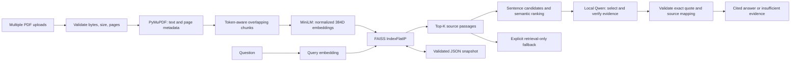
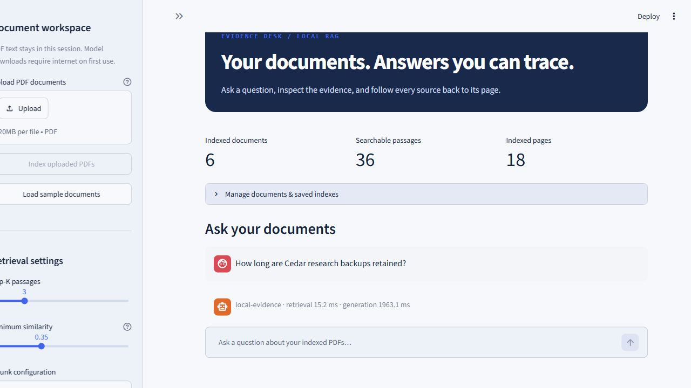
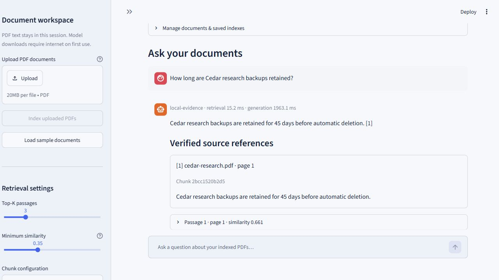

# Evidence Desk - AI Document Question Answering with RAG

[](https://github.com/nguyenbao140506-debug/ai-document-qa-rag/actions/workflows/ci.yml)

A local PDF question-answering application that makes every answer inspectable. Upload research notes, manuals, or policies, ask a question, and trace the supporting sentence to the original filename and page.

The project combines **Sentence Transformers**, **FAISS**, **PyMuPDF**, **Streamlit**, and a small **Qwen** language model. It includes a reproducible synthetic corpus, retrieval experiments, separate answer-quality diagnostics, automated tests, and actual execution records.

## Why this project

Finding a fact across several PDFs takes time, and an unsupported AI answer is difficult to trust. Evidence Desk retrieves relevant passages and uses a local LLM to select a supporting sentence. A second answerability check and a deterministic validator decide whether to show it. The application constructs citations from stored metadata; the model cannot invent a filename or page number.

**This is conservative, extractive question answering.** Answers are natural-language sentences quoted from documents, rather than unrestricted generated summaries. A valid quotation can still be irrelevant or misleading; the evaluation measures relevance separately from source integrity.

## Architecture



## Features

- Multiple text PDFs, 20 MB / 200 pages per file, with clear errors for corrupt, encrypted, empty, and scanned-only documents.
- Normalized text, one-based page references, page-local token windows, content-based document IDs, stable chunk IDs, and duplicate-content prevention.
- Cosine retrieval using normalized float32 vectors and exact FAISS inner-product search, configurable Top-K and minimum similarity.
- Add/remove documents, session-specific indexes and conversation history, shared model caching with inference locks, and explicit re-indexing when chunk settings change.
- Local Qwen inference, validated filename/page citations, expandable source passages, insufficient-evidence responses, and a clearly labelled retrieval-only mode.
- Download/restore bounded JSON index snapshots. No pickle, native FAISS deserialization, or arbitrary uploaded file paths. Restores check integrity, model identity, dimensions, normalization, and exact page/chunk mappings, then re-embed source text to check the stored vectors. This adds verification cost during restore; it does not authenticate the original PDF or its claimed metadata.
- No paid APIs, API keys, remote inference, or uploaded private PDFs in Git.

**UI verification scope:** live browser testing verified sample-document indexing, questions, and source cards. Multi-PDF upload handling was verified with real Streamlit `UploadedFile` objects and PDF bytes. The in-app browser's operating-system file-picker automation was unavailable; a successful automated browser file-picker run is not claimed.

## Installation

Use Python **3.13** for the tested pinned environment. Create an isolated environment from the repository root:

```powershell
python -m venv .venv
.\.venv\Scripts\Activate.ps1
python -m pip install -r requirements-lock.windows-py313.txt -r requirements-dev.txt
python -m pip install --no-deps -e .
python scripts/download_models.py
```

The lock captures the tested Windows/Python 3.13 runtime dependency closure, including patched transitive packages. For a different OS, install `requirements.txt` instead and audit the resolved dependencies; activate with `source .venv/bin/activate` on macOS/Linux. CI runs the offline suite on Linux. `reportlab` is needed only to regenerate the corpus. The committed synthetic PDFs can be used directly.

For CUDA, install a compatible **patched PyTorch 2.13 or later** wheel from the [official PyTorch installation selector](https://pytorch.org/get-started/locally/) before installing the remaining requirements. The application chooses CUDA when the installed PyTorch reports it available, otherwise CPU. Do not disable TLS verification to download packages or models.

The development audit reused existing packages through a project virtual environment without changing the base Conda environments. The commands above use a clean environment for reproducibility.

## Run locally

```powershell
python -m streamlit run app.py
```

Open **http://127.0.0.1:8501**. The checked-in configuration binds to localhost.

1. Upload text PDFs and click **Index uploaded PDFs**, or click **Load sample documents**.
2. Keep the default 224-token chunks / 48-token overlap and Top-K 3, or adjust and explicitly apply the chunk configuration.
3. Ask: **How long are Cedar research backups retained?**
4. Inspect the cited sentence, its filename/page, and the expandable retrieved passages.
5. Use **Manage documents & saved indexes** to remove documents or download/restore an index snapshot. Snapshots contain extracted text; keep them private.

Switch to **Retrieval only** to search without loading the LLM. If the model is missing or generation fails, the UI labels the fallback and displays passages without pretending they are generated answers. Model files and private indexes are excluded from Git.

## Models and hardware

| Component | Model / implementation | Notes |
| --- | --- | --- |
| Embeddings | `sentence-transformers/all-MiniLM-L6-v2` | 384 dimensions; CPU by default; English-oriented |
| Search | FAISS `IndexFlatIP` | Exact cosine ranking after normalization; CPU |
| Answer selection | `Qwen/Qwen2.5-0.5B-Instruct` | Local safetensors; deterministic decoding; sentence identifiers and answerability check |
| PDF extraction | PyMuPDF | Text layer only; no OCR |
| UI | Streamlit | Local, single-user application |

Model revisions are pinned in `src/ragqa/config.py`; the downloader excludes duplicate PyTorch/ONNX variants. Downloads total roughly 1.1 GB. Qwen FP16 weights require about 1 GB before runtime overhead on CUDA; CPU float32 inference requires more RAM. An RTX 4060 8 GB ran the initial small-model trials, but larger models are outside the tested scope. The final tested runtime is patched PyTorch 2.13 **CPU**: CUDA-wheel downloads stalled, so the existing system CUDA environment was preserved and the smaller CPU wheel was used. Actual device and package versions are recorded with each experiment.

The small LLM is deliberately constrained to quoted evidence. This improves auditability and reduces text fabrication, but limits synthesis, reasoning, and answer coverage. Model cards: [MiniLM](https://huggingface.co/sentence-transformers/all-MiniLM-L6-v2), [Qwen](https://huggingface.co/Qwen/Qwen2.5-0.5B-Instruct).

## Retrieval methodology and evaluation

The original corpus contains **six fictional handbooks, 18 pages, 36 answerable questions, and eight unanswerable questions**. Questions include exact expected evidence and one-based source references. No real personal documents or third-party articles are redistributed. Corpus data uses CC0; application code uses AGPL-3.0-or-later.

The experiments compare 128/24 and 224/48 WordPiece token windows. Both fit within MiniLM's 256-token input limit, including special tokens. Chunks never cross page boundaries. Recall requires a retrieved chunk to contain the complete target evidence sentence on the correct source page. MRR is truncated at five results. Latency includes warm CPU query encoding and FAISS search, and excludes indexing, model loading, and LLM generation.

The initial measured retrieval run produced:

| Chunk tokens / overlap | Recall@1 | Recall@3 | Recall@5 | MRR@5 | p50 / p95 |
| --- | ---: | ---: | ---: | ---: | ---: |
| 128 / 24 | 88.89% | 100% | 100% | 0.9398 | 4.48 / 6.17 ms |
| 224 / 48 | 100% | 100% | 100% | 1.0000 | 4.43 / 5.43 ms |

Source: [`evaluation/results/retrieval.json`](evaluation/results/retrieval.json). Raw repetitions and ranked source references are included. Later generation experiments repeat retrieval and retain their own timing records; results vary with background load.

**Answer generation is evaluated separately.** The final CPU run in [`evaluation/results/final.json`](evaluation/results/final.json) correctly answered **30/36** answerable questions, refused **8/8** unanswerable questions, and produced **30/30** source-correct, expected-fact-supporting citations. It also refused six answerable questions. Source-validity and expected-answer relevance are distinct metrics. Earlier experiments are retained to show why the answer contract changed; `full.json` is an intermediate GPU run, not the final runtime report. See [`evaluation/README.md`](evaluation/README.md) for denominators, scoring limitations, and reproduction details.

This is a small, synthetic, exploratory benchmark. The default configuration was selected using this same corpus; there is no held-out tuning/test split. The numbers do not establish performance on arbitrary PDFs, languages, scanned pages, or real enterprise data.

## Reproduce tests and experiments

```powershell
$env:USE_TF = '0'
$env:OMP_NUM_THREADS = '4'
$env:OPENBLAS_NUM_THREADS = '4'
python scripts/build_corpus.py
python -m pytest -m "not integration" --cov=ragqa
python -m pytest -m integration
python -m ruff check .
python -m ruff format --check .
python -m bandit -r src app.py scripts -ll
python -m pip_audit -r requirements-lock.windows-py313.txt --no-deps --disable-pip
python scripts/evaluate.py --generation --output evaluation/results/reproduced.json
python scripts/evaluate_adversarial.py
```

Offline tests use a clearly labelled test embedding double; integration tests use the real downloaded Sentence Transformer and FAISS. No large LLM is downloaded by CI. Genuine JUnit, coverage, static-security, and experiment records are kept in `evaluation/results/`. Tests are not evidence of general model accuracy.

A clean CI-style environment can install `requirements-ci.txt`, then install this package with `--no-deps -e .`, and run `pytest -m "not integration"`. This intentionally omits PyTorch, Sentence Transformers, Transformers, and all model weights; it verifies offline contracts and UI startup, not real model inference. Full local tests use the complete runtime lock and downloaded models.

## Screenshots and portfolio evidence

Genuine screenshots from the running Streamlit application:





The corpus contact sheet shows all 18 generated pages: [`assets/corpus-contact-sheet.png`](assets/corpus-contact-sheet.png).

- [`docs/PORTFOLIO_EVIDENCE.md`](docs/PORTFOLIO_EVIDENCE.md): verified features, test records, evaluation, reproduction, and limitations.
- [`docs/CV_BULLETS.md`](docs/CV_BULLETS.md): three concise, evidence-backed English CV bullets.
- [`docs/SECURITY.md`](docs/SECURITY.md): threat model, safeguards, and remaining risks.
- [`docs/PUBLICATION.md`](docs/PUBLICATION.md): verified public commit, successful GitHub Actions run, and actual remote logs.

## Limitations and future improvements

- No OCR, table reconstruction, image understanding, cross-page chunks, or unrestricted multi-document synthesis.
- A correct source reference does not guarantee that a sentence answers the question. Similarity thresholds and local answerability checks are heuristics, not calibrated confidence or a complete hallucination defence.
- Prompt boundaries, suspicious-instruction filtering, constrained output, and plain-text rendering reduce prompt-injection impact; they do not solve adversarial document poisoning.
- PDF parsing happens in-process. Byte, page, character, document, and chunk limits reduce resource use, but do not replace process isolation for hostile multi-user uploads.
- Index checksums detect accidental corruption, not a malicious party who rewrites the snapshot and checksum. Snapshots are not proof of document authenticity.
- The app is for localhost, single-user use. Production hosting needs authentication, per-user storage controls, parser isolation, quotas, monitoring, and a separate deployment review.
- Next steps: a held-out real-world corpus with permission, human grounding review, calibrated answerability, stronger reranking, OCR, richer multilingual embeddings, and optional larger local models.

Code is licensed under AGPL-3.0-or-later; original synthetic evaluation data is CC0. Downloaded models retain their respective upstream licenses.
